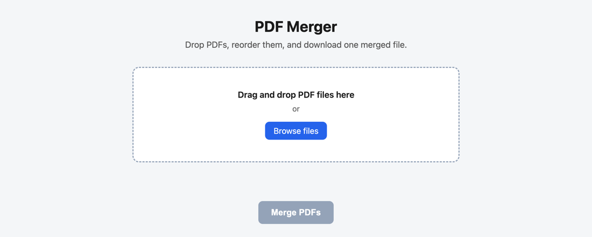

# PDF Merger

A small web app to merge PDF files. Drag and drop PDFs, reorder them, and download the merged result.
Built with FastAPI and pypdf; the merging happens on your own machine.



## Setup

Requires [Python 3.10+](https://www.python.org/downloads/).

**macOS / Linux**

```bash
cd PDF-merger
python3 -m venv .venv
source .venv/bin/activate
pip install -r requirements.txt
```

**Windows (PowerShell)**

Install Python with **Add python.exe to PATH** enabled, then:

```powershell
cd path\to\PDF-merger
python -m venv .venv
.\.venv\Scripts\Activate.ps1
pip install -r requirements.txt
```

In Command Prompt, use `.venv\Scripts\activate.bat` instead of `Activate.ps1`. If PowerShell blocks
activation, run this once: `Set-ExecutionPolicy -ExecutionPolicy RemoteSigned -Scope CurrentUser`

## Run

With the virtual environment active:

```bash
uvicorn app.main:app --reload
```

Open [http://127.0.0.1:8000](http://127.0.0.1:8000) in your browser.

## Usage

1. Drag PDF files onto the drop zone, or click to browse.
2. Reorder files by dragging rows in the list.
3. Click **Merge PDFs** to download the combined file.
